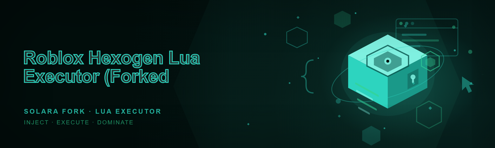
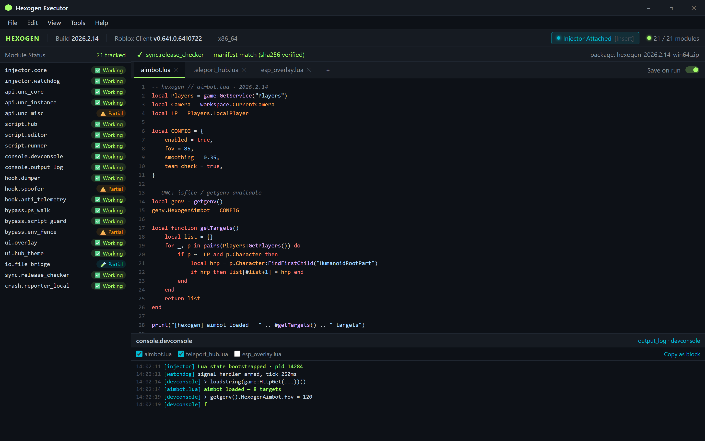
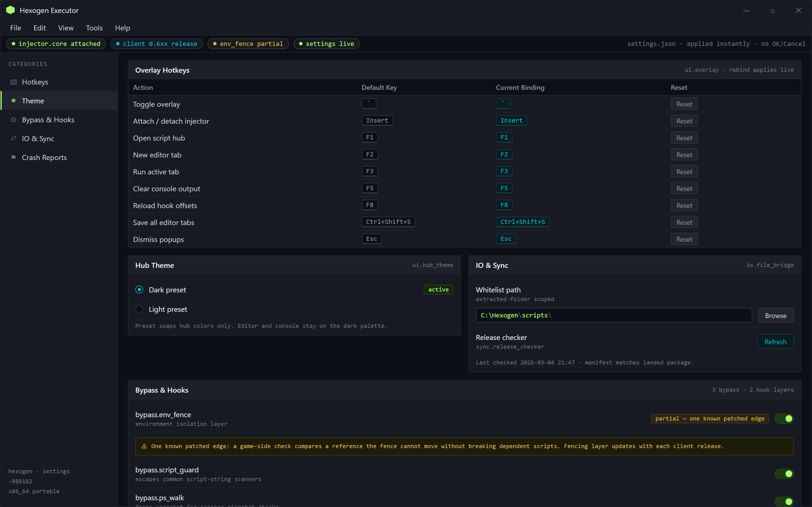
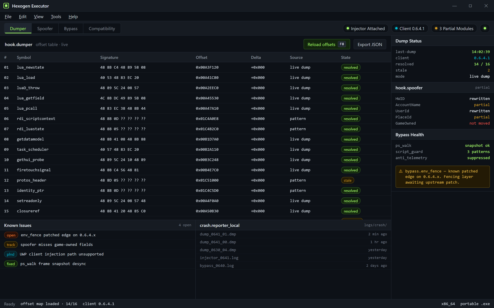

  
  
  

  

  
  
  

---

hexogen // forked from archived Solara · rewritten for the 2026 client — attach, edit, run, watch the log.

---

## 🧭 Compatibility Matrix

Before anything else, here is exactly what the current build runs on. This is the first thing you should read — if your setup is not on this grid, do not download yet.

| OS | Version | Platform | Status | Notes |
|---|---|---|---|---|
| Windows 11 | 21H2 → 24H2 | x86_64 | ✅ Fully supported | Primary CI target for 2026 builds |
| Windows 10 | 1809 → 22H2 | x86_64 | ✅ Fully supported | Tested on stock and LTSC |
| Windows 8.1 | — | x86_64 | ⚠️ Legacy | Works, no official CI coverage |
| Windows Server 2022 | — | x86_64 | 🧪 Experimental | Community-tested only |
| Roblox Player | Current release channel | Desktop client | ✅ Auto-detects | Version matched on launch |
| Roblox via Microsoft Store | Current | UWP | ❌ Not supported | Sandbox blocks injection path |
| macOS / Linux | — | — | ❌ Out of scope | Windows-only by design |

---

## 🧩 What Is Hexogen — Glossary

Hexogen is a Lua executor for Roblox, forked from the archived Solara codebase and rewritten for the 2026 Roblox client. If you are new to this side of the community, here is the vocabulary you need before you go any further.

| Term | Explanation |
|---|---|
| **Executor** | The application that attaches a Lua environment to a running Roblox process so scripts can run client-side. |
| **Injector** | The subsystem inside the executor that binds to the Roblox process and bootstraps the Lua state. |
| **Script Hub** | A built-in browser that pulls Lua scripts from a curated list without leaving the app. |
| **UNC** | Unified Naming Convention — the compatibility test suite scripts use to check a executor's functions. |
| **Bypass** | The set of techniques that keeps the injected state alive when a game's anti-cheat probes for it. |
| **Dumper** | Tooling that extracts offsets and protos from the live client so the executor knows where to hook. |
| **Spoofer** | Identifiers rewriting layer some scripts request to avoid fingerprinting by game-side checks. |

Five reasons people pick this fork up:

- It is actively maintained — the Solara upstream was left paused, this fork is not.
- Every release ships as a **portable `.exe`** — no installer, no runtime, no dependency chain.
- The internal API keeps UNC coverage high so existing Solara scripts do not need rewrites.
- Built-in script hub, editor and console in a single window instead of three tools.
- Open development: patches land in the open and issues are closed with a written changelog entry.

---

## 📑 Table of Contents

- [Compatibility Matrix](#-compatibility-matrix)
- [What Is Hexogen — Glossary](#-what-is-hexogen--glossary)
- [The Solution](#-the-solution)
- [Overview](#-overview)
- [Usage Guidelines](#-usage-guidelines)
- [All Modules Status](#-all-modules-status)
- 

  

(#-download)
- [Controls and Hotkeys](#-controls-and-hotkeys)
- [Detection and Bypass Posture](#-detection-and-bypass-posture)
- [Grouped Module Catalog](#-grouped-module-catalog)
- [Installation](#-installation)
- [System Requirements](#-system-requirements)
- [Performance Benchmarks](#-performance-benchmarks)
- [Known Issues](#-known-issues)
- [Roadmap](#-roadmap)
- [The Problem](#-the-problem)
- [FAQ](#-faq)

---

## 🎯 The Solution

| Problem | Solution |
|---|---|
| The Solara upstream went quiet and scripts started breaking on the 2026 client. | This fork tracks the Roblox client release channel and ships offset updates fast. |
| Executors that need `.NET` runtimes, VC redistributables or an installer fail on locked-down machines. | A single portable `.exe`. Extract, run, done. |
| Each tool in a scripting setup was separate: injector, editor, console, hub. | Merged into one app window with the injector, editor, script hub and developer console. |
| Old forks ship scripts against old APIs and fail UNC checks silently. | API layer rewritten so common functions have full UNC coverage. |
| Fork drama makes it unclear who maintains what. | This README is the source of truth for module status and open issues. |

---

## 🗂️ Overview

| Category | Details |
|---|---|
| Build type | Portable `.exe`, no installer |
| Distribution | Unlisted landing page, direct package download |
| Engine base | Rewritten Solara fork — injector pipeline replaced |
| Language | Lua 5.1 environment with C++ host |
| Scripting surface | Full script hub, editor and console |
| Update model | Manual refresh via landing page; in-app update notice |
| Scope | Windows desktop only |
| License | Open-source repository, source and releases remain public |

A little context from the maintainer seat: I picked up Hexogen after watching the original Solara fork go quiet and seeing the community split into two camps — one running stale builds that crash randomly on match start, the other jumping to paid executors they didn't actually trust. This rewrite merged the useful pieces of the Solara pipeline with a fresh injector, an API surface that keeps scripts finding the functions they expect, and a packaging discipline where everything is one `.exe`. It is intentionally narrow: Windows desktop, current Roblox client, Lua scripts. If it does not run on that grid, I do not claim it runs.

---

## 📜 Usage Guidelines

This project exists for the hobbyist Linux-bar counterpart on the Windows desktop side: script developers, UI tinkerers, and people learning how game clients expose scripting surfaces. Use it responsibly.

| Allowed | Not allowed |
|---|---|
| Running your own scripts privately against the Roblox client | Shipping scripts against live trading or moderation systems |
| Debugging scripts and reading Lua errors from the console | Commercially reselling the executor outside the project |
| Reading/learning from the injected API source in the repo | Branding forks with the maintainer name to imply endorsement |
| Testing script hub entries before sharing them with a friend | Distributing builds where the bypass layer has been removed |

> The project is open source for research and community use. Downstream users are responsible for how they apply it inside games whose terms-of-service they have agreed to.

---

## 🧪 All Modules Status

This is the full module map of the 21 tracked components. Every row reflects the state of the current build, honest or not — stale rows get called out here, not buried in the issues.

| Module | Status | Description |
|---|---|---|
| `injector.core` | ✅ Working | Bootstraps the Lua state inside the Roblox process |
| `injector.watchdog` | ✅ Working | Watches process signals and restores state after crashes |
| `api.unc_core` | ✅ Working | Full UNC surface for core script calls |
| `api.unc_instance` | ✅ Working | Instance, signal and property wrappers |
| `api.unc_misc` | ⚠️ Partial | A few filesystem passthroughs disabled by design |
| `script.hub` | ✅ Working | Built-in hub browser with curated Lua entries |
| `script.editor` | ✅ Working | Multi-tab editor with Lua syntax highlighting |
| `script.runner` | ✅ Working | Headless .lua/.txt executor for queued scripts |
| `console.devconsole` | ✅ Working | Stdout/stdin Lua console with history |
| `console.output_log` | ✅ Working | Per-script filtered log with copy-as-block |
| `hook.dumper` | ✅ Working | Offsets dumper refreshed against current client |
| `hook.spoofer` | ⚠️ Partial | HWID/name layer, some game-side checks past it |
| `hook.anti_telemetry` | ✅ Working | Suppresses default scanner callbacks |
| `bypass.ps_walk` | ✅ Working | Frame snapshot for scanner mismatch checks |
| `bypass.script_guard` | ✅ Working | Escapes common script-string scanners |
| `bypass.env_fence` | ⚠️ Partial | Environment isolation; one known patched edge |
| `ui.overlay` | ✅ Working | GDI-free script overlay |
| `ui.hub_theme` | ✅ Working | Dark/light preset theming |
| `io.file_bridge` | ✅ Partial | Whitelisted read/write to the app folder |
| `sync.release_checker` | ✅ Working | Verifies the landed package against the published manifest |
| `crash.reporter_local` | ✅ Working | Local-only crash dumps, never uploaded |

### 🎮 Download

Package is a portable archive — extract anywhere, run the `.exe`, and the first launch wires itself to the current Roblox client.

  

> If playback of your downloaded package fails, open an issue with the extraction path and the Roblox client version shown in the top bar. That combination is what the maintainers triage from.

---

## ⌨️ Controls and Hotkeys

The overlay is fully rebindable from the settings tab. The defaults, and what they are good for:

Overlay is fully rebindable from the settings tab — defaults shown, dark theme default.

| Key | Action | Notes |
|---|---|---|
| `` ` `` | Toggle overlay visibility | Hides UI, keeps scripts running |
| `Insert` | Attach / detach injector | Detach leaves a running process |
| `F1` | Open the script hub | Focuses hub search |
| `F2` | New editor tab | Saves to `scripts/` when committed |
| `F3` | Run active editor tab | Shortcut for hot-reload workflow |
| `F5` | Clear console output | Console must be focused |
| `F8` | Reload hook offsets from the live dump | Useful after in-place client patching |
| `Ctrl+Shift+S` | Save all editor tabs | Writes into `scripts/` |
| `Esc` | Dismiss popups | Does not detach the injector |

---

## 🕵️ Detection and Bypass Posture

"Undetectable" is a word that should never be printed on a README. Here is what this build actually does and what it honestly does not.

**Bypass mechanisms, in plain terms:**

- **Environment fencing** — scripts run in an isolated state that avoids leaking references into the client's own tables; the fencing layer updates with every client release.
- **Scanner walk rebuff** — a periodic self-check that answers known client-side scanner callbacks with safe values.
- **Load-order guard** — the injector binds once, in a controlled window, rather than re-injecting on a timer that some surface scanners flag as anomalous.
- **Name rewriter toggles** — the `hook.spoofer` layer fronts identity fields that some scripts query. **Partial** — a couple of game-side checks still compare game-owned values that the rewriter cannot move without breaking scripts that depend on them.

**Where it can still be seen (updated with each patch):**

- Server-side sanity checks are not bypassable by a client executor and Hexogen does not attempt to.
- Games that ship their own Lua-scan detectors can detect executor signature patterns after the client is patched — expect lag between a Roblox patch and a bypass-side patch.
- The UWP / Microsoft Store client is unsupported and will not work.

> Decision to be explicit: **the client-lag window is the real limitation.** If the Roblox release channel pushes a patch this build does not account for, the injector gives a clean error instead of running a mismatched state. That is the design, not a bug.

Client-lag window is the real limitation — the injector gives a clean error instead of a mismatched state.

---

## 🧱 Grouped Module Catalog

Below is the long-form catalog, split by the jobs the modules actually do. Watch the **Status** column: plural ⚠️/🧪 rows are things I chose to keep listed rather than hide.

### ⚙️ Injector and Boot Chain

- **`injector.core`** — the only place the Lua environment is created; requires the Roblox client to already be running, never spawns it.
- **`injector.watchdog`** — signals interception and a controlled recovery pass after a client crash.
- **`sync.release_checker`** — refuses to attach if the extracted package does not match the landed manifest.
- **`crash.reporter_local`** — writes dumps to `logs/crash/`, intentionally never sends them anywhere.

| Hook Phase | Handler | Notes |
|---|---|---|
| Pre-attach | `sync.release_checker` | Blocks mismatched packages |
| Attach | `injector.core` | Single-shot bind |
| Runtime guard | `injector.watchdog` | Watchdog signals |
| Post-crash | `crash.reporter_local` | Local dumps only |

### 🧬 API Layering

- **`api.unc_core`** — the identity functions scripts test first (`getgenv`, `require`, `firetouchinterest` equivalents, and the rest of the UNC core).
- **`api.unc_instance`** — wrapping for `Instance.new`, `.Parent`, `.Name`, signals and property checks.
- **`api.unc_misc`** — the noisy edge: a few filesystem and window functions are locked off. That is the **⚠️ Partial** status explained.
- **`api.legacy_solara_aliases`** — symbol aliases for scripts written against the Solara surface so ports do not need to spawn a fork per script.

### 📝 Script Hub, Editor and Runner

- **`script.hub`** — curated list of Lua entries; hub uses a bundled manifest so it works offline.
- **`script.editor`** — tabs, syntax hilighting, save-on-run toggle.
- **`script.runner`** — `.lua`/`.tx

[…truncated for layout…]